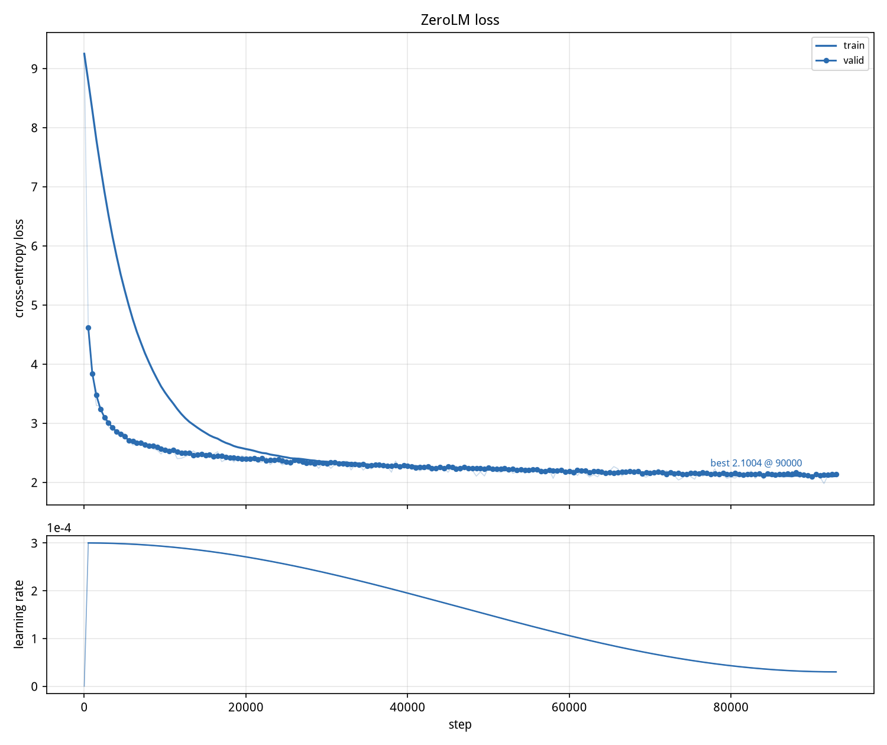

# ZeroLM

[](https://github.com/warter666/ZeroLM/actions/workflows/tests.yml)

从零手写一个中文小语言模型:分词、Transformer、优化器、训练循环、采样,全部自己实现,
不调用 `nn.Transformer` / `torch.optim.AdamW` / `cross_entropy` 等现成封装。
语料为中文版 TinyStories(200 万篇小故事),单卡 RTX 4060 上 2 小时 10 分训完 3 个 epoch,
best validation loss **2.1004**(折合 0.512 bits/byte),能用任意前缀生成连贯中文故事。

> 起点是 [Stanford CS336 Assignment 1](https://stanford-cs336.github.io/) 的组件划分,
> 但项目目标不止于作业:把「数据处理 → 分词 → 预训练 → 推理优化 → 采样分析」整条链路跑通并留下实测记录。

## 实现

- **Byte-level BPE**:词型频次统计、增量 pair 合并、tie-break 规则;10000 词表,5.96 bytes/token,roundtrip 无损
- **Transformer**:RoPE(预计算 cos/sin 表)、RMSNorm、SwiGLU 三矩阵门控前馈、causal MHA、pre-norm Block
- **优化**:数值稳定的 cross_entropy、AdamW(decoupled weight decay)、warmup + cosine、梯度裁剪
- **训练**:随机批采样、bf16 autocast、SDPA、`torch.compile`、断点续训、csv 记录、峰值显存
- **推理**:temperature / top-k / top-p 采样 + **KV cache**(见 [notes/kv_cache.md](notes/kv_cache.md))

模块与参数量逐项拆解见 [notes/implementation.md](notes/implementation.md);测试 **72 个**。

## 模型

| 超参 | 值 |
| --------------- | ---------------------------------------- |
| vocab size | 10000 |
| context length | 256 |
| d_model / heads | 512 / 16 |
| layers | 4 |
| d_ff | 1344 |
| RoPE theta | 10000 |
| 参数量 | **22.70M**(`--tie-embeddings` 后 17.58M) |

## 快速开始

```bash
uv sync                                  # 依赖 + 本地包
uv run pytest tests/ -q                  # 72 个测试,纯 CPU

uv run python scripts/download_data.py    # 下载中文 TinyStories
uv run python scripts/train_tokenizer.py  # 训练 BPE(10k 词表)
uv run python scripts/prepare_data.py     # 全量编码为 .npy(多进程,可断点续跑)

uv run python -m zerolm.run_training --experiment-name first \
  --train-data data/zh_train.npy --valid-data data/zh_valid.npy \
  --vocab-size 10000 --sdpa --compile --device cuda

uv run python scripts/generate.py --run-dir experiments/first --prompt "从前"
```

训练产物在 `experiments/<name>/`(metrics.csv / config.json / checkpoint,不入库),
`scripts/plot_loss.py` 画曲线、`scripts/report.py` 汇总指标、`scripts/sampling_experiment.py` 做旋钮扫参。

## 结果

| 指标 | 值 |
| -------------------- | --------------------------------------------------------------------- |
| best validation loss | **2.1004** @ step 90,000 |
| 末次 validation loss | 2.1320 @ step 93,000 |
| 训练规模 | 3 epoch / 93,000 步 / 761.9M token(254.1M 唯一 token × 3) |
| 单卡耗时 | 130 分钟(RTX 4060 Laptop 8GB,83 ms/step) |
| 语料压缩 | 5.96 bytes/token(10000 词表) |
| 每字节编码成本 | 0.5121 bit/byte(见 [notes/training.md](notes/training.md) 的口径说明) |



上:train(细线原始 + 粗线 EMA)与 valid(点线,标注 best);下:cosine 学习率。
曲线无发散;前两个 epoch valid 一直在 train 下方,容量还有余量。
末尾 6 次 eval 里 valid 从 2.1004 回升到 2.13 附近、连续上升 4 次,
是 3 个 epoch 预算用完的信号,但幅度约 1.5%,还不算明显过拟合。

生成示例(`temperature=0.8, top_p=0.95`,前缀「从前」):

```text
从前，有一只懒猫，名叫胡须。胡须喜欢玩他的球。有一天，他去公园玩球。但当他到达那里时，
他看到了一些奇怪的事情。球开始腐烂。胡须去找他的朋友，一只名叫 Tweetie 的小鸟……
胡须很伤心，但他了解到他应该听妈妈的话，不要玩腐烂的东西。<|endoftext|>
```

## 进一步实验

首页只放结论,推导与数据在 notes:

| 文档 | 内容 |
| -------------------------------------------------- | ----------------------------------------------------------------------- |
| [notes/implementation.md](notes/implementation.md) | 模块划分、参数量账目、每步耗时、数据规模、BPE 采样策略 |
| [notes/training.md](notes/training.md) | 训练配方、bits/byte 口径、多 epoch 与过拟合判据、续训陷阱 |
| [notes/sampling.md](notes/sampling.md) | temperature / top-k / top-p 三旋钮扫描:候选数方差实证「固定 vs 自适应」 |
| [notes/kv_cache.md](notes/kv_cache.md) | KV cache 原理、两个启用前提、等价性测试、加速实测 |

两个值得一提的结论:

- **采样**:top-k 的候选数标准差恒为 0(数量固定),top-p 在同一参数下能从 ±1.1 波动到 ±756
  (数量自适应);temperature 是唯一会让模型崩坏的旋钮 —— `t=1.6` 起 EOS 命中率就塌了。
- **KV cache**:正确性用「两条路径输出逐 id 相同」钉死(含采样路径的随机数消耗顺序)。
  实测 **CPU 3.85×(B=1)/ 8.33×(B=5)**;GPU 只有 **0.92×–1.20×**,且**依赖是否编译**。
  用 profiler 查过原因:每步 **CPU 派发 16.0 ms、GPU 实际只算 1.32 ms**,
  生成期间 GPU 利用率均值 **18.6%** —— cache 只能省那 1.32 ms 里的一部分,
  理论上限 1.05×。GPU 上真正的大头是 `torch.compile`(整体 **3.1×**),与 cache 是不同层次的优化。
- **tie-embeddings 消融**(同 seed、同 3 epoch,只切 `--tie-embeddings`):
  参数量 22.69M → 17.57M,而 best valid **2.1004 → 2.0438**、bits/byte 0.5121 → 0.4982、
  ms/step 83 → 81。模型本就欠拟合时,共享 embedding 带来的正则化收益
  大于少掉 5.1M 参数的损失。见图 `figures/tie_ablation.png`。

## 许可

代码 MIT([LICENSE](LICENSE))。语料 [TinyStories-Zh-2M](https://huggingface.co/datasets/RobinChen2001/TinyStories-Zh-2M)(MIT)。

## 致谢

[Stanford CS336](https://stanford-cs336.github.io/) Assignment 1(组件划分与测试基准)、
Karpathy 的 [minbpe](https://github.com/karpathy/minbpe)(BPE 实现思路)与
[nanoGPT](https://github.com/karpathy/nanoGPT)(pre-norm + RoPE 结构与训练配方)、
[TinyStories](https://arxiv.org/abs/2305.07759)(语料与可行性结论)。
