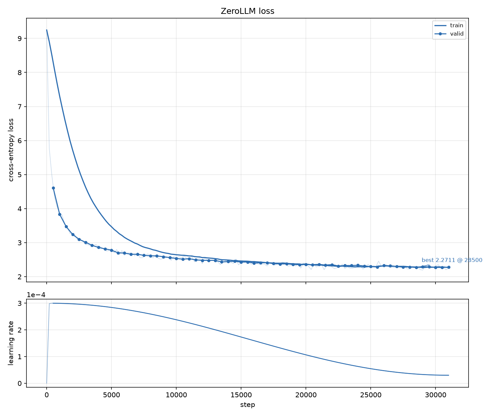
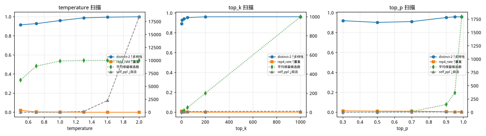

# ZeroLLM

[](https://github.com/warter666/ZeroLM/actions/workflows/tests.yml)

From zero to LLM:从零开始(不依赖任何框架内置的 Transformer 实现)训练一个中文小语言模型,作为 [Stanford CS336: Language Modeling from Scratch](https://stanford-cs336.github.io/) Assignment 1 的课程实践项目。

课程作业的原题是在英文 TinyStories 上复现一个 GPT 风格的语言模型;本项目把语料换成中文,把整条流水线——分词、模型、优化、训练、采样——全部亲手实现一遍,以检验课程内容是否真正掌握。

## 为什么是 TinyStories

英文原版 [TinyStories](https://arxiv.org/abs/2305.07759)(Eldan & Li, 2023)证明了一个关键结论:**当语料足够简单时,1–10M 参数的小模型也能生成连贯的叙事文本**。这让它成为小算力下学习语言模型训练的理想语料——不需要数据中心,一张消费级/入门级云 GPU 就能完整走完"数据 → 分词 → 预训练 → 采样"的全流程。

本项目使用其中文版本 [TinyStories-Zh-2M](https://huggingface.co/datasets/RobinChen2001/TinyStories-Zh-2M)(MIT):约 200 万条中文小故事,842MB。

## 模块划分

每个模块独立成文件、独立成测试,对应 CS336 assignment1 的组件划分:

| 模块 | 文件 | 内容 |
| --- | --- | --- |
| BPE 训练 | `zerollm/train_bpe.py` | 字节级 BPE:词型频次统计、增量合并、tie-break 规则(实现思路参考 Karpathy 的 [minbpe](https://github.com/karpathy/minbpe)) |
| 分词器 | `zerollm/tokenizer.py` | encode / 流式 encode_iterable / decode,special token 处理 |
| 模型 | `zerollm/model.py` | Linear / Embedding / RMSNorm / SwiGLU / RoPE / causal MHA / pre-norm Block / TransformerLM |
| 损失与优化 | `zerollm/loss_optimizer.py` | cross_entropy(数值稳定)、AdamW(decoupled weight decay)、warmup+cosine LR、梯度裁剪 |
| 训练组件 | `zerollm/training.py` | get_batch 随机批采样、checkpoint 存取 |
| 训练循环 | `zerollm/run_training.py` | CLI:断点续训、eval 记录 csv、自动 checkpoint |
| 生成 | `zerollm/generating.py` | temperature + top-k + top-p(nucleus)采样 |

全部模型组件(注意力、归一化、优化器)均为手写 PyTorch 实现,不调用 `nn.Transformer`、`torch.optim.AdamW` 等现成封装。

## 默认模型规模

| 超参 | 值 |
| --- | --- |
| vocab size | 10000 |
| context length | 256 |
| d_model | 512 |
| layers / heads | 4 / 16 |
| d_ff | 1344 |
| RoPE theta | 10000 |
| 参数量 | **22.70M**(不绑定);`--tie-embeddings` 后 **17.58M** |

参数量的账(实测 `model.num_parameters()`):

| 组成 | 参数 |
| --- | --- |
| token embedding | 5.12M |
| lm_head(默认独立) | 5.12M |
| 4 层 × (attn 1.05M + SwiGLU 2.06M + 2×RMSNorm) | 12.46M |
| **合计(默认)** | **22.70M** |

早先文档写的“≈17M”是**权重绑定**(lm_head 复用 embedding)时的数字 22.70−5.12=17.58M。代码默认不绑定,
所以真实是 22.70M。要 17M 就加 `--tie-embeddings`(注意:绑定时 embedding 必须用 std=0.02 初始化,
否则 logits 尺度爆炸、初始 loss 直接 44.7 —— 已内置处理)。

速度(本地 RTX 4060 Laptop 实测,bs32×ctx256,毫秒/步):默认 217 → `--sdpa` 112 → `--sdpa --compile` 83。
A10 约为 4060 的 2–3 倍,10k 步 5–8 分钟,30k 步 20 分钟量级。

## 快速开始

```bash
uv sync                       # 安装依赖(含本地包 zerollm)
uv run pytest tests/ -v       # 模块测试(59 个)

# 1. 下载语料
uv run python scripts/download_data.py

# 2. 训练 BPE(10k 词表,语料采样 200MB)
uv run python scripts/train_tokenizer.py

# 3. 全量编码为 token id(.npy,多进程,可断点续跑)
uv run python scripts/prepare_data.py

# 4. 本地训练(小模型冒烟)
uv run python -m zerollm.run_training --experiment-name smoke \
  --train-data data/zh_train.npy --valid-data data/zh_valid.npy --vocab-size 10000

# 5. 生成
uv run python scripts/generate.py --run-dir experiments/<name> --prompt "从前"

# 6. 画 loss 曲线(读 metrics.csv)
uv run python scripts/plot_loss.py --run-dir experiments/<name>

# 7. 汇总指标(best valid / bits per byte)
uv run python scripts/report.py --run-dir experiments/<name>

# 8. 采样旋钮对比实验(temperature / top-k / top-p)
uv run python scripts/sampling_experiment.py --run-dir experiments/<name>
```

云 GPU 一键流程(冒烟 → 数据 → 训练):`bash scripts/train_cloud_sys.sh --all`

## 目录

```
zerollm/        模型与训练库
scripts/        数据下载、BPE 训练、预处理、生成、画图、采样实验、上传、云训练脚本
tests/          模块测试
experiments/    训练产物(metrics.csv / config / checkpoint,大文件不入库)
data/           语料与 token id(不入库)
figures/        loss 曲线等
```

## 训练配方

- 优化器:AdamW,β=(0.9, 0.95),weight decay 0.01,梯度裁剪 max_norm 1.0
- 学习率:3e-4 峰值,200 步线性 warmup,cosine 衰减到 3e-5
- batch:32 × 256 tokens;混合精度:bf16 autocast(Ampere 及以上)
- 规模:31,000 步 ≈ 1 epoch(全量编码后 train 254.1M tokens)
- 加速:`--sdpa`(flash 内核)与 `--compile`,见上节实测
- 评估:每 500 步在验证集上算 loss(20 个 batch),与 train loss 一并写入 `metrics.csv`

## 训练结果

本地 RTX 4060 Laptop(8GB)跑完 **1 个 epoch / 31,000 步 / 254.1M tokens**,耗时 45 分钟(87 ms/step)。

| 指标 | 值 |
| --- | --- |
| 初始 loss | 9.25(≈ ln 10000,随机初始化) |
| **best valid loss** | **2.2711 @ step 28,500** |
| 末次 valid loss | 2.2813 |
| 参数量 | 22.70M(不绑定 embedding) |
| 词表 / 上下文 | 10000 / 256 |
| bits/token | 3.2765 |
| bytes/token(语料实测) | 5.9178 |
| **bits/byte** | **0.5537** |

> 为什么报 bits/byte:val loss 是「每 token 的交叉熵(nats)」,换个词表大小这个数就变(词表越大,
> 同一段文本的 token 越少、每 token loss 通常越大),所以它**不能**跨分词器比较 —— 参考仓库的
> 英文 val 1.36 与本仓库的中文 2.2711 并不是同一把尺子。
> 折算:`bits/byte = loss / ln2 / (语料字节数 / token 数)`,
> 本仓库 = 2.2711 / 0.6931 / 5.9178 = **0.5537**,含义是每字节原始中文只需 0.55 bit 编码
> (等价于把字节压缩了 14.45 倍)。报任何“比英文好/差”的结论前,都应该先算到这个口径。
>
> `uv run python scripts/report.py --run-dir experiments/zh-1ep` 可一键重算。



上:train(细线原始 + 粗线 EMA)与 valid(点线,best 已标注);下:cosine 学习率,200 步 warmup 到 3e-4 后衰减到 3e-5。
曲线无发散、无尖尖,valid 全程在 train 下方 —— 1 个 epoch 没有过拟合迹象。

重画方式:`python scripts/plot_loss.py --run-dir experiments/zh-1ep`(支持多个 run 叠画对比)。

生成效果(`temperature=0.8, top_p=0.95`,前缀“从前”):

```text
从前，有一只懒猫，名叫胡须。胡须喜欢玩他的球。有一天，他去公园玩球。但当他到达那里时，
他看到了一些奇怪的事情。球开始腐烂。胡须去找他的朋友，一只名叫 Tweetie 的小鸟……
胡须很伤心，但他了解到他应该听妈妈的话，不要玩腐烂的东西。<|endoftext|>
```

## 采样旋钮实验

`zerollm/generating.py` 支持三个旋钮,作用和调节方式不同:

| 旋钮 | 改什么 | 特点 |
| --- | --- | --- |
| temperature | 分布**形状**:`logits / t`,t<1 变尖、t>1 变平 | 同时影响候选集合大小和相对概率 |
| top-k | **候选数量固定**为 k 个 | 不随分布形状变化,分布很尖时仍会带上 k−1 个坏候选 |
| top-p | 保留累计概率达到 p 的**最小集合** | 候选数量自适应:分布尖时少、平时多 |

`scripts/sampling_experiment.py` 做对比实验:固定同一前缀与 RNG 种子,一次只动一个旋钮,
统计连贯性(self_ppl / EOS 命中率 / 有效字符率)、多样性(distinct-1/2/3)、
重复模式(重复 4-gram 占比 / max 4-gram 频次),另计「平均保留候选数 ± std」作为
“数量固定 vs 数量自适应”的直接证据。输出 `metrics.csv`、`samples.md` 与三旋钮曲线图。

### 实测结论(checkpoint `zh-1ep`,step 31000,val 2.2711)

完整报告与样例见 [`notes/sampling.md`](notes/sampling.md)。三句话:

1. **temperature 改的是分布形状**。候选数 6212±2103(t=0.5)→ 10000±0.3(t=2.0),
   而 `self_ppl` 从 3.23 爆到 18424;`t=1.6` 时 EOS 命中率已从 1.00 掉到 0.73,
   **`t=2.0` 只剩 0.13,输出退化成词沙拉**。
2. **top-k 改的是候选数量且固定**。k=1→1000 时候选数恒等于 k、**std 全程 0.0**,
   全档 EOS 命中 1.00(从不崩坏);但 k 从 200 加到 1000 时 distinct-2 不动(0.962),
   `self_ppl` 却从 9.95 涨到 11.77 —— 固定数量在分布变尖的地方白送概率质量。
3. **top-p 改的是候选数量且自适应**。p=0.9 时候选数 147.6**±109.9**(波动 74%),
   p=0.99 时 1795.3±756.3;同样不崩坏(EOS 1.00)。达到相同多样性时更省:
   p=0.9 用 148 个候选拿到 distinct-2 0.952 / ppl 9.31,而 top-k=1000 用 1000 个候选
   才拿到 0.962 / ppl 11.77。

因此默认配方是 `temperature=1.0 + top_p=0.95`(见 `generate.py`),只在需要硬约束时用 top-k。



从左到右依次为 temperature / top-k / top_p 扫描。绿点虚线是**平均保留候选数**:
中图是完美直线(top-k 数量固定),右图先平后翘(top-p 自适应),左图随温度升高跑满词表。
灰虚线 `self_ppl` 在 temperature 图的右端直接爬出屏幕 —— 那就是崩坏。

## 许可

代码 MIT([LICENSE](LICENSE))。语料 [TinyStories-Zh-2M](https://huggingface.co/datasets/RobinChen2001/TinyStories-Zh-2M) 亦为 MIT;
原始英文 [TinyStories](https://arxiv.org/abs/2305.07759) 语料的许可请见其数据集页。

## 参考与致谢

- [Stanford CS336: Language Modeling from Scratch](https://stanford-cs336.github.io/) Assignment 1:模块划分、bpe/模型/优化的接口与测试基准
- Andrej Karpathy 的 [minbpe](https://github.com/karpathy/minbpe):字节级 BPE 的实现思路(词型计数、增量 pair 统计、merge 顺序与特殊 token 处理)
- Andrej Karpathy 的 [nanoGPT](https://github.com/karpathy/nanoGPT):pre-norm + RoPE 结构、AdamW 超参、warmup+cosine 训练配方
- [TinyStories](https://arxiv.org/abs/2305.07759)(Eldan & Li, 2023):语料设计与小模型可行性结论
- [TinyStories-Zh-2M](https://huggingface.co/datasets/RobinChen2001/TinyStories-Zh-2M)(MIT):中文语料
